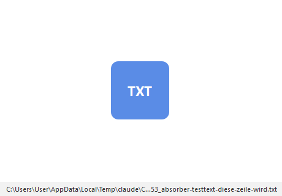

# Absorber

**English** | [Deutsch](README_de.md)

[](LICENSE)
[](https://www.python.org/)
[](https://doc.qt.io/qtforpython/)
[]()
[](https://github.com/file-bricks)

> You have something in the clipboard and you need it as a file — because you want to
> point at it. Absorber turns it into one and hands you back the path.



Absorber lives in the tray as a funnel. Click it and whatever sits in the clipboard
becomes a real file: an image becomes a PNG, text becomes a `.txt`, rich text can become
`.html`. The path of the new file goes straight back into your clipboard, ready to paste
into a chat, a prompt, an issue or a command line.

The window itself is deliberately a white rectangle. It is not an unfinished placeholder —
it is the surface you drop things onto.

---

## Table of contents

| Section | What it covers |
|---|---|
| [Why](#why) | The problem this solves |
| [Install](#install) | Requirements and setup |
| [Use](#use) | Tray, window, keyboard |
| [Settings](#settings) | Every option and what it does |
| [Local model naming](#local-model-naming) | Optional Ollama integration |
| [Not to be confused with Gardener](#not-to-be-confused-with-gardener) | Name collision, different tool |
| [Development](#development) | Tests and layout |
| [Roadmap](#roadmap) | What is deliberately not in 0.1.0 |

---

## Why

Clipboard content has no address. You cannot link to it, attach it, drop it into a prompt
as a file reference or hand it to a tool that takes a path. The usual workaround is
"open an editor, paste, save as, navigate, name it, copy the path" — six steps for
something that should be one.

Absorber makes it one step, and the result is the **path**, not the file. Pointing at
things is done with paths.

## Install

Requires Python 3.11 or newer.

```bash
git clone https://github.com/file-bricks/absorber.git
cd absorber
pip install -e .
```

Start it:

```bash
python -m absorber        # or: absorber
START.bat                 # Windows
./start.sh                # macOS / Linux
```

Windows first, but nothing in the core is Windows-only: the clipboard, the tray and the
paths all go through Qt.

## Use

| Action | What happens |
|---|---|
| **Left-click the tray icon** | Materialize the clipboard right now |
| **Tray → Materialize** | Same thing, from the menu |
| **Tray → Recent files** | The last 10 files; clicking one copies its path |
| **Tray → Mode** | Switch between desktop and virtual |
| **Right-click in the window → Paste** | Materialize, with the kind symbol shown |
| **Ctrl+V in the window** | Same |

After writing, the kind of file that was created appears as a symbol in the middle of the
white area, shrinks and fades out. The status line shows the path for three seconds; the
full path is always in the tooltip.

Closing the window does not quit Absorber. It keeps living in the tray. Quit from there.

### What it can absorb

| Clipboard holds | Becomes | Note |
|---|---|---|
| An image | `.png` | Screenshots, copied pictures |
| Text | `.txt` or `.md` | Which one is a setting |
| Rich text / HTML | `.html` | Off by default |
| A list of files | Copies in the target folder | Off by default |

## Settings

Open with **Tray → Settings…**. The configuration lives in `config.json` under the
platform config directory (`%APPDATA%\absorber\` on Windows).

| Setting | Default | What it does |
|---|---|---|
| **Target folder** | your desktop | Where files are written in desktop mode. Empty means the desktop, resolved by Qt — on a machine with redirected folders that is the OneDrive desktop, as intended. |
| **Mode** | Desktop | `Desktop` writes to the target folder. `Virtual` writes to a temp folder and cleans up after itself. |
| **Virtual retention** | 7 days | How long virtual files survive. `0` disables cleanup entirely. |
| **Text formats** | `.txt` | Which extensions text may use. Ticking `.html` also makes rich text a kind of its own. |
| **Copy file lists** | off | Whether files copied in the file manager get duplicated into the target folder. |
| **Path to clipboard** | on | Puts the new file's path in the clipboard. This is the actual answer to your request. |
| **Model naming** | on | Ask a local model for a file name. |
| **Model** | `auto` | `auto` uses the first installed model, or name one explicitly. |

A full field-by-field legend — what each field asks, why it is needed and where the value
takes effect — is in [`docs/BLUEPRINT.md`](docs/BLUEPRINT.md).

## Local model naming

If [Ollama](https://ollama.com/) is running on `http://127.0.0.1:11434`, Absorber asks it
for a three-to-five-word name based on the first 800 characters of the text.

**Every failure is silent and costs you nothing.** No Ollama, a timeout, a missing model,
an empty answer — in each case the fallback name applies:

```
2026-09-20_141233_meeting-notes-from-today     text, named from its first words
2026-09-20_141233_image                        an image
2026-09-20_141233_image_2                      and the next one, on collision
```

A naming suggestion must never cost you a file. The probe gets one second, the naming
request three.

## Not to be confused with Gardener

[Gardener](https://github.com/ellmos-ai/GARDENER) uses the words `absorb()`,
`materialize()` and `.absorber/` for pulling **files into its database**. That is a
different tool solving a different problem, and the two do not interact. Absorber here
goes the other way: clipboard content **out** into the file system.

## Development

```bash
pip install -e ".[dev]"
QT_QPA_PLATFORM=offscreen pytest
```

91 tests, no network access, no real clipboard required. The core is deliberately free of
GUI imports:

| Module | Responsibility |
|---|---|
| `absorber/core.py` | Detect the kind, write the file, return the paths |
| `absorber/naming.py` | Slugs, collisions, the Ollama client with injectable HTTP |
| `absorber/config.py` | Defaults, load/save, resolved folders, virtual cleanup |
| `absorber/recent.py` | The recent files list |
| `absorber/window.py` | White area, paste, the shrinking kind symbol |
| `absorber/tray.py` | Funnel icon, menu, recent list |
| `absorber/settings_dialog.py` | One widget per blueprint field |

## Roadmap

Deliberately left out of 0.1.0:

- **Global hotkey** — materialize without touching the tray
- **Autostart** — start with the session
- **More formats** — RTF, SVG, audio from the clipboard
- **Directory support** in copied file lists (currently skipped)

## License

MIT — see [LICENSE](LICENSE).
